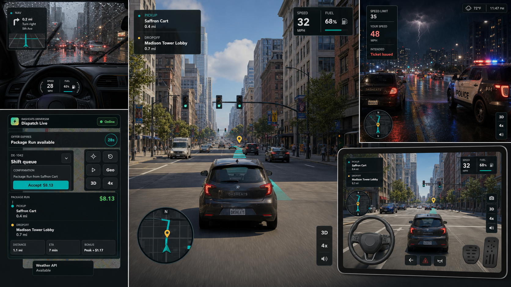

# DashEats

**A browser-based, geospatial delivery and rideshare driving simulator built around real-world locations, task-driven gameplay, and scalable 3D map streaming.**



DashEats turns the daily work of a courier or rideshare driver into a structured driving game. Players accept jobs, navigate real roads, collect packages or passengers, complete verification steps, and deliver safely before time expires. The experience combines a dispatch workflow inspired by delivery and rideshare platforms with first-person and third-person vehicle control, real-world geography, traffic rules, dynamic weather, vehicle management, and progression systems.

> [!NOTE]
> This initial public commit preserves the project specification, gameplay design, architecture, and generated visual showcase. The previous local browser-prototype source directory is no longer available on the workstation and is not represented as present in this commit. Application source will be restored or rebuilt in follow-up commits.

## Project Vision

DashEats is designed as a browser-native simulation game where location is the game board. A proprietary activity engine can create delivery, courier, or passenger jobs with real pickup and drop-off coordinates. The player must physically drive the route using a car or bike while responding to road conditions, traffic, weather, time pressure, and customer confirmation requirements.

The long-term goal is a scalable simulation platform that supports:

- Real-world locations and route-aware tasks.
- Photorealistic 3D buildings, roads, and terrain streamed as needed.
- First-person cockpit and third-person chase cameras.
- Car and bike handling with meaningful differences in acceleration, braking, grip, fuel use, and risk.
- Delivery, package, and rideshare task variations.
- Live weather and day/night conditions.
- Keyboard, touch, gamepad, and PC steering-wheel input.
- Desktop, Android, iPhone, and iPad browsers.

## Core Gameplay Loop

1. **Go online** and receive a generated offer.
2. **Review the job** including pickup, drop-off, distance, ETA, payout, bonus, cargo or passenger details, and confirmation rules.
3. **Accept or decline** before the offer timer expires.
4. **Drive to pickup** using real-world route guidance while following speed limits and traffic controls.
5. **Complete pickup checks**, such as entering an OTP, confirming a passenger, or waiting for a store order.
6. **Drive to the destination** while managing time, fuel, vehicle condition, weather, traffic, and police enforcement.
7. **Complete drop-off proof**, such as a photo, signature, delivery confirmation, or passenger completion step.
8. **Receive payout and a run grade** based on speed, safety, damage, tickets, delays, and successful confirmation.

## Task System

The activity engine is intended to support multiple job types from the same location-based contract:

| Job type | Pickup flow | Drop-off flow | Possible complications |
| --- | --- | --- | --- |
| Food delivery | Arrive, park, wait for order | Photo or handoff confirmation | Store queue, missing order, late preparation |
| Package delivery | Scan or collect package | Photo, signature, or secure placement | Fragile cargo, timed delivery, access restrictions |
| Rideshare | Passenger OTP or identity check | Passenger completion | Passenger wait time, route change, rating impact |
| Priority courier | Item verification | Recipient OTP or signature | Strict timer, bonus conditions, multiple stops |

Each task may contain:

- Geographic pickup and drop-off coordinates.
- Offer expiration and completion time limits.
- Base pay, distance pay, peak bonus, tips, and deductions.
- Cargo, customer, or passenger notes.
- OTP, signature, scan, or photo-proof requirements.
- Store preparation time and queue simulation.
- Multi-stage status progression from offer to completion.

## Driving Simulation

DashEats is modeled as a driving game rather than a passive moving map. The player controls steering, throttle, braking, and camera perspective while the simulation tracks:

- Speed, acceleration, braking distance, steering response, and traction.
- Weather-dependent grip and visibility.
- Vehicle collisions and persistent damage.
- City speed-limit zones and overspeed duration.
- Traffic lights, road flow, and surrounding vehicles.
- Police enforcement, tickets, and fines.
- Fuel or battery consumption and roadside refueling.
- Safety score, payout deductions, and end-of-run grades.
- Car and bike profiles with different performance characteristics.

## Real-World 3D Environment

The browser runtime is designed around CesiumJS and Google Photorealistic 3D Tiles rather than a Unity player. This allows the world to be streamed into WebGL-capable browsers while preserving real buildings, terrain, and city context.

Planned and prototyped runtime responsibilities include:

- **CesiumJS** for global-scale geospatial rendering and 3D Tiles streaming.
- **Google Photorealistic 3D Tiles** for real-world buildings and terrain.
- **Leaflet and OpenStreetMap** for the lightweight dispatch and fallback map.
- **OSRM-compatible routing** for route geometry and navigation fallback.
- **Three.js or custom WebGL layers** for vehicles, interactive props, effects, and gameplay-specific geometry where appropriate.
- **Google Weather API** for live weather conditions, with simulated weather when API access is unavailable.

Google Geospatial Creator is a Unity and ARCore authoring workflow, not the browser runtime itself. DashEats uses browser-compatible geospatial technologies while keeping task coordinates and scene anchors portable to a future native client.

## World Simulation

The environment is intended to feel inhabited and reactive:

- Traffic vehicles follow road flow and respond to intersections.
- Traffic lights cycle and affect safe-driving evaluation.
- Police vehicles detect sustained speeding and reckless behavior.
- Rain, fog, storms, and sunlight alter visibility and grip.
- Wet roads produce reflections, spray, and longer stopping distances.
- Day/night progression changes lighting, traffic mood, and visibility.
- Fuel stations become required stops as the vehicle runs low.
- Pickup and drop-off areas use route beacons and proximity triggers.
- Audio and screen effects communicate weather, collisions, horns, fines, task changes, and confirmations.

## Cameras and Controls

### Camera modes

- First-person cockpit view.
- Third-person chase view.
- Dispatch map view.
- Optional geospatial overview for route inspection.

### Input methods

- Keyboard controls for steering, acceleration, braking, camera, and horn.
- Touch controls with steering, pedals, camera switch, task actions, and map tools.
- Standard browser gamepads.
- PC steering wheels and pedals through the Gamepad API when exposed by the browser.

Wheel mode is designed to disable keyboard and mobile driving HUDs so inputs do not conflict. Calibration stores steering and pedal ranges locally, while compatible devices may receive collision and ticket vibration feedback.

## Responsive Experience

The interface is designed for desktop and mobile browsers, including:

- Android phone portrait and landscape.
- iPhone portrait and landscape.
- iPad portrait and landscape.
- Desktop and laptop screens.

The responsive design accounts for iOS safe areas, browser chrome, dynamic viewport height, device rotation, 44-pixel minimum touch targets, and reflow of the dispatch panel, route computer, driving HUD, pedals, camera controls, and map toolbar.

Representative tested viewport sizes from the prototype were:

`360x800`, `375x667`, `393x852`, `667x375`, `844x390`, `768x1024`, and `1024x768`.

## Streaming and Rendering Strategy

Photorealistic city data is too large to load as a conventional level. DashEats therefore treats the world as a continuously streamed, bounded working set.

Key optimization principles include:

- Bounded GPU tile caches instead of unbounded map retention.
- Progressive and foveated tile loading that prioritizes the road ahead.
- Dynamic screen-space error based on performance profile.
- Request culling for tiles that are no longer relevant after camera movement.
- Reduced update frequency for distant traffic, props, and geospatial anchors.
- Level of detail for player vehicles, traffic, lights, particles, and shadows.
- Adaptive render resolution and weather-particle density.
- Suspended refinement and cache trimming when the 3D view is hidden.
- Device-aware Performance, Balanced, Quality, and Adaptive profiles.
- Frame-rate monitoring that steps quality down quickly and restores it conservatively.

Google map content remains in the provider-approved runtime cache. The application does not attempt persistent or offline storage of licensed photorealistic tiles.

## Proposed Architecture

```text
Activity Engine
  -> job offers, coordinates, timers, pay, confirmation requirements

Game State
  -> task stage, vehicle state, fines, fuel, damage, safety, payout

Routing Layer
  -> route geometry, navigation prompts, distance, ETA

World Layer
  -> CesiumJS, Google 3D Tiles, fallback map, streamed terrain

Simulation Layer
  -> vehicle physics, traffic, signals, police, weather, day/night

Presentation Layer
  -> HUD, task drawer, route computer, touch controls, effects, audio

Input Layer
  -> keyboard, touch, gamepad, steering wheel and pedals
```

For production, the task engine and player state should move behind authenticated backend APIs. Client-side simulation can remain responsive, but payouts, task completion, progression, and anti-cheat checks require server authority.

## API and Security Model

No API keys are committed to this repository.

Development keys should be:

- Restricted by HTTP referrer.
- Limited to only the required Google APIs.
- Kept in local environment configuration or a secure runtime settings panel.
- Replaced immediately if exposed in source control or public logs.

Production should proxy sensitive business APIs through a backend and use provider-approved browser restrictions for public map tokens.

## Production Requirements

Before a commercial release, the project needs:

- A licensed routing and road-rules data source.
- Backend task orchestration and persistent player accounts.
- Secure media upload for delivery proof.
- Anti-cheat and server-side task validation.
- Commercial vehicle, character, sound, and effect assets.
- Road-aware collision and navigation data separate from visual 3D tiles.
- Telemetry, crash reporting, analytics, and live-operations tooling.
- Accessibility, localization, privacy, and legal review.
- Load, device, network, and battery testing at production scale.

## Current Repository Status

This commit establishes the public product overview and preserves the current visual direction. The next repository milestone is to restore or rebuild the browser vertical slice, followed by repeatable setup instructions, automated checks, and a hosted demo.

## Roadmap

- [ ] Restore the browser prototype source.
- [ ] Add repeatable local development and build scripts.
- [ ] Add environment-variable templates without secrets.
- [ ] Reconnect the dispatch map, 3D drive view, and activity engine.
- [ ] Add deterministic vehicle and task-system tests.
- [ ] Add hosted preview deployment.
- [ ] Add backend persistence and authenticated profiles.
- [ ] Add multiplayer events, fleet progression, and live operations.

## Project Name

**DashEats DriverSim** is the game experience. **DashEats** is the repository and platform name.
