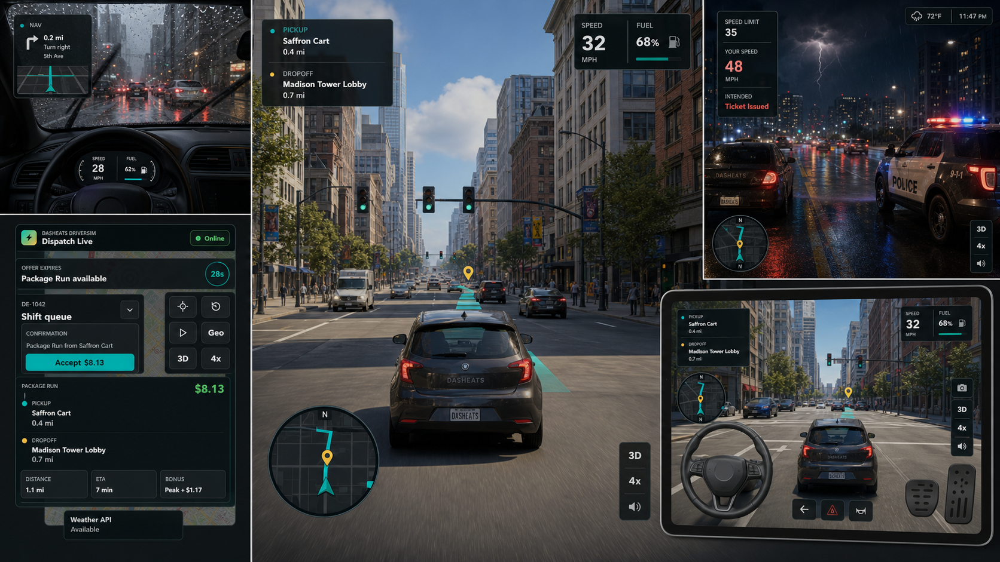
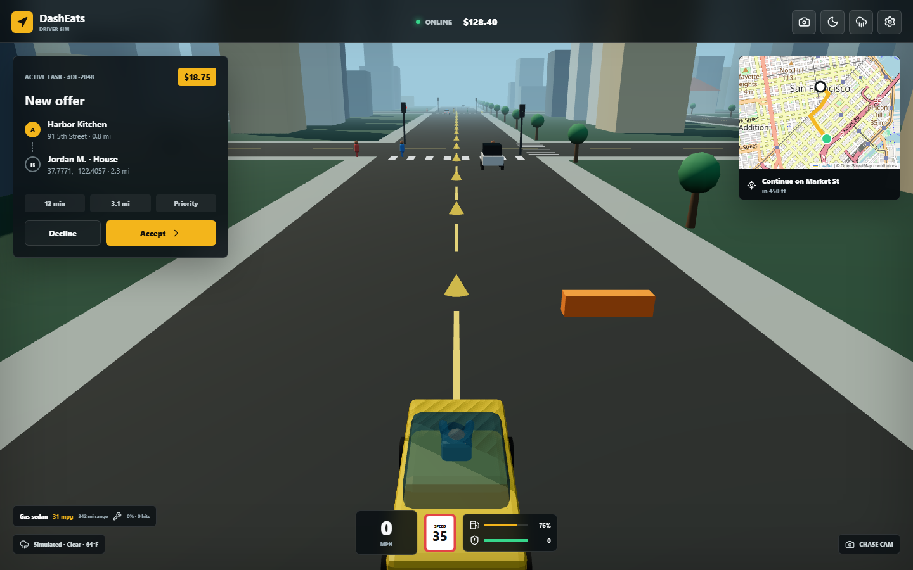
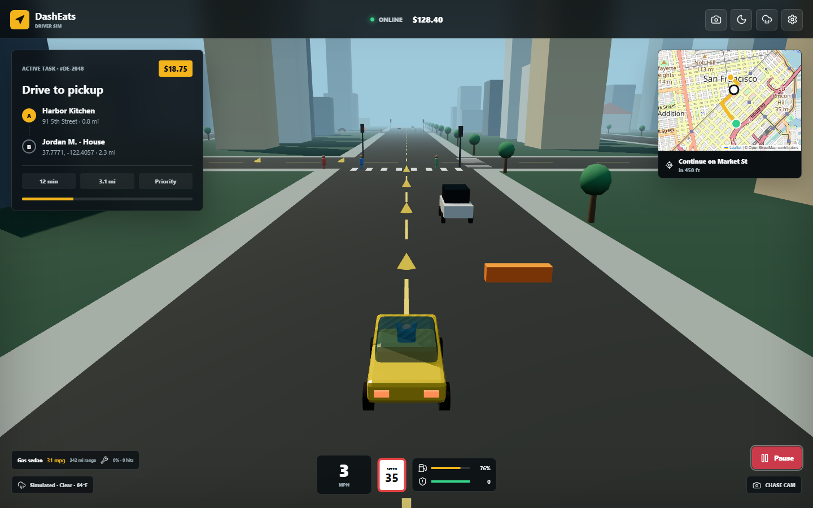
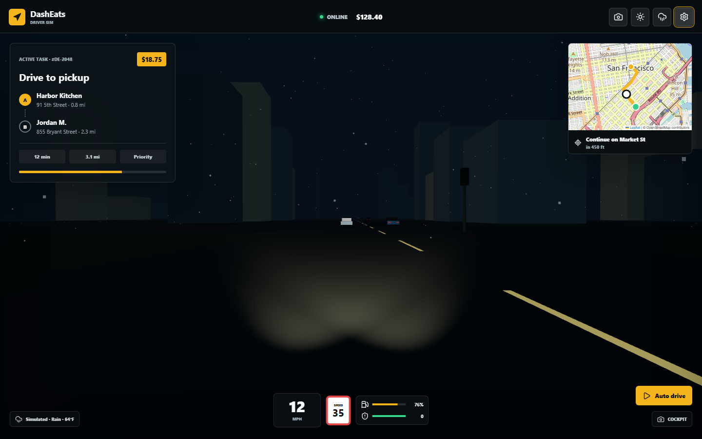
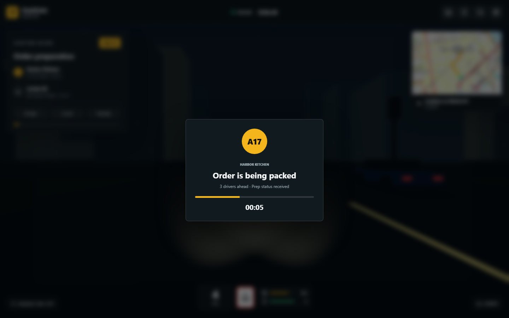
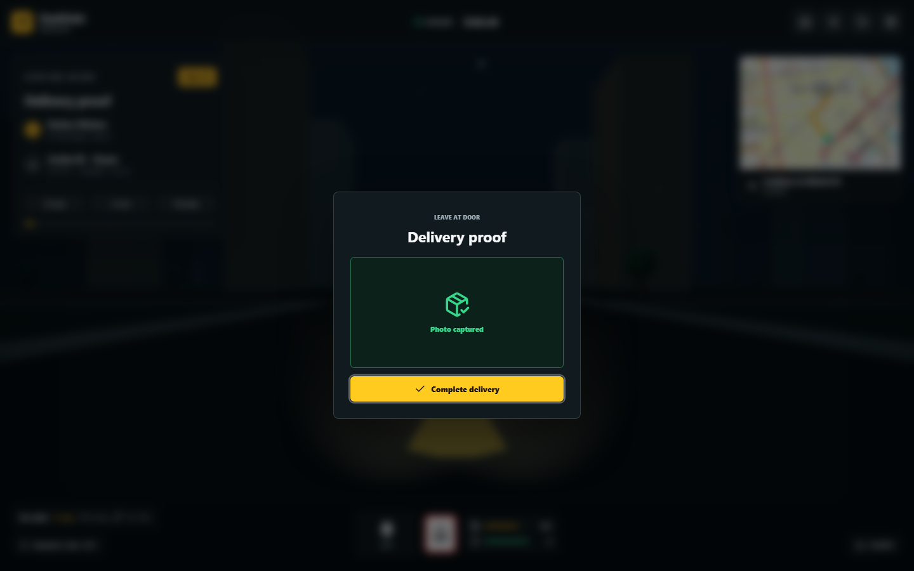
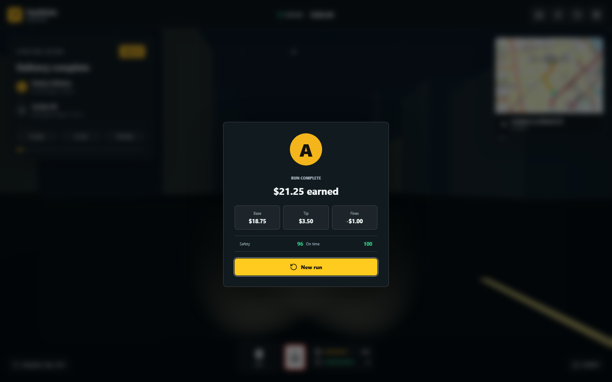
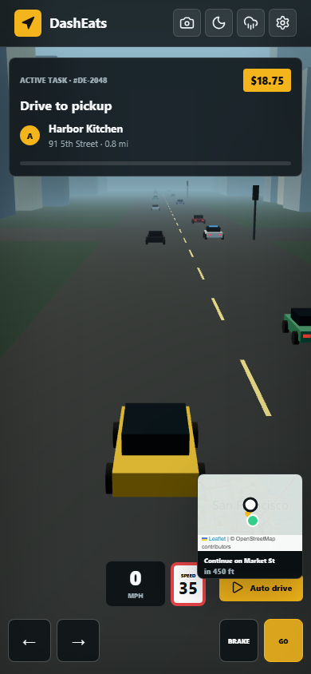
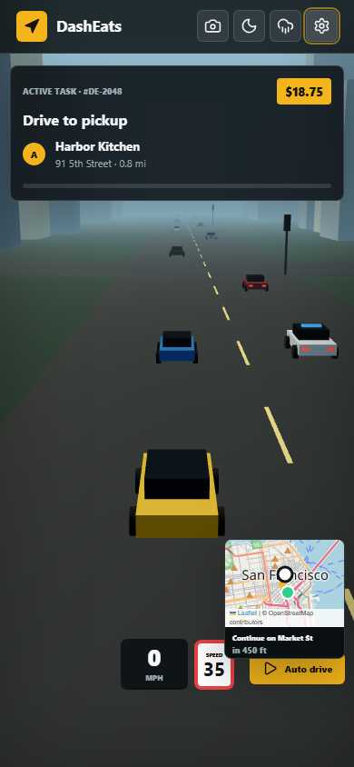

# DashEats DriverSim

**A browser-native delivery and rideshare driving simulator built around real locations, task workflows, vehicle control, live weather, and streamable 3D worlds.**

[](https://vite.dev/)
[](https://react.dev/)
[](https://threejs.org/)
[](#verification)



DashEats turns courier and rideshare work into a structured driving game. Players review an offer, drive to a real-world pickup, complete an OTP check, experience store preparation delays, drive to the customer, capture delivery proof, and receive a scored payout. The vertical slice is playable with keyboard, touch controls, assisted driving, or a browser-exposed steering wheel/gamepad.

## Product Demo

### Dispatch and driving

| Job offer | Third-person drive |
| --- | --- |
|  |  |

### Weather, pickup, and store operations

| Cockpit in rain at night | Store preparation queue |
| --- | --- |
|  |  |

### Delivery completion

| Photo proof | Run score and payout |
| --- | --- |
|  |  |

### Responsive controls

| Mobile driving HUD | Wheel mode with touch HUD disabled |
| --- | --- |
|  |  |

## Playable Flow

1. Review payout, pickup, destination, distance, ETA, and priority.
2. Accept the task and drive to the restaurant.
3. Enter the pickup OTP. The demo code is `4281`.
4. Wait for the simulated store queue and preparation timer.
5. Drive to the customer while managing speed, weather, fuel, and road traffic.
6. Capture photo proof and confirm delivery.
7. Review base pay, tip, fines, safety score, on-time score, and run grade.

## Current Features

- First-person cockpit and third-person chase cameras.
- Deterministic throttle, braking, steering, grip, drag, fuel use, and speed enforcement.
- Moving traffic, a police vehicle, traffic signals, city buildings, lane markings, and fog.
- Clear, rain, storm, daytime, and nighttime scene states.
- Vehicle headlights, rain effects, audio feedback, and screen-state transitions.
- Real OpenStreetMap tiles and a route-aware Leaflet minimap.
- Google Weather API current-conditions integration.
- Lazy Google Photorealistic 3D Tiles mode rendered through CesiumJS.
- OTP, store wait, photo proof, payout, fines, safety, and task-state progression.
- Keyboard, touch, browser gamepad, and PC wheel/pedal input paths.
- Android, iPhone, iPad, laptop, and desktop responsive layouts.
- Accessible labels, focus states, reduced-motion handling, and mobile safe-area support.

## Controls

| Action | Keyboard | Touch / wheel |
| --- | --- | --- |
| Accelerate | `W` or `ArrowUp` | GO pedal / accelerator axis |
| Brake | `S` or `ArrowDown` | BRAKE pedal / brake axis |
| Steer | `A` `D` or arrow keys | Direction buttons / steering axis |
| Camera | Camera button | Camera button |
| Assisted drive | Auto drive button | Auto drive button |

Selecting **Wheel** input mode removes the touch driving controls so hardware and HUD input cannot conflict.

## Real-World Platform

The default DriverSim world is deterministic and key-free, which makes the task flow available to every visitor. Real-world services are loaded only when requested:

- **Leaflet + OpenStreetMap** provide the lightweight route computer and street context.
- **Google Weather API** maps current conditions into rain, storm, daylight, and temperature state.
- **CesiumJS + Google Photorealistic 3D Tiles** stream real buildings and terrain from the Map Tiles API.
- **Three.js** owns the interactive vehicle, traffic, lights, effects, and deterministic gameplay scene.

Google tiles are a visual geospatial layer. A commercial release still needs a licensed road graph and collision surface for lane-level physics, traffic rules, and authoritative navigation; photogrammetry alone is not a drivable physics mesh.

## Streaming and Performance

- The HUD shell, Leaflet map, Three.js world, and Cesium bridge compile into separate browser chunks.
- Cesium is downloaded only after Google 3D mode is selected.
- Google tiles use bounded cache and overflow budgets, screen-space error, skipped levels of detail, request rendering, and a capped render cadence.
- Buildings use instanced meshes instead of one draw call per structure.
- Telemetry is throttled independently from the render loop.
- Render pixel ratio, antialiasing, and shadow work adapt to viewport size.
- Traffic reuses geometry and materials and updates only compact transforms.
- Mobile portrait uses a camera-specific offset and simplified status HUD.
- Static production assets ship with immutable one-year browser caching.

## Google API Setup

Enable these APIs in the same Google Cloud project:

1. **Map Tiles API** for Photorealistic 3D Tiles.
2. **Weather API** for current conditions.

Create a browser key and restrict it to those APIs. Add HTTP referrer restrictions for:

```text
http://localhost:5173/*
http://127.0.0.1:4178/*
https://YOUR-VERCEL-DOMAIN/*
```

Then create `.env.local`:

```bash
VITE_GOOGLE_MAPS_API_KEY=your_restricted_browser_key
```

The key is intentionally absent from this repository. A `VITE_` key is included in the browser bundle by design, so referrer and API restrictions are mandatory. The settings panel can also retain a key in `sessionStorage` for the current tab only.

## Run Locally

```bash
npm install
npm run dev
```

Open `http://localhost:5173`.

Production build and preview:

```bash
npm run build
npm run preview
```

## Verification

Unit tests validate valid and invalid task-state transitions:

```bash
npm test
```

Playwright runs the complete delivery lifecycle in Chromium, checks that WebGL produces a nonblank canvas, and verifies mobile touch and wheel-mode behavior:

```bash
npx playwright install chromium
npm run test:e2e
```

The end-to-end suite also produces the screenshots in `docs/showcase/` from the actual production build.

## Architecture

```text
Activity / task state machine
  -> offer -> pickup -> OTP -> queue -> drop-off -> proof -> payout

Input adapters
  -> keyboard | touch | gamepad | steering wheel

Simulation
  -> vehicle state | traffic | lights | police | fuel | weather | scoring

World providers
  -> deterministic Three.js city
  -> lazy CesiumJS + Google Photorealistic 3D Tiles

Geospatial services
  -> OpenStreetMap route context | Google Weather API

Presentation
  -> responsive HUD | task panels | effects | audio | modal workflows
```

## Production Boundaries

This repository is a production-built vertical slice, not a finished commercial driving platform. Server-authoritative jobs, accounts, persistent progression, secure proof uploads, anti-cheat validation, licensed road rules, commercial assets, and telemetry remain backend milestones. Google 3D mode currently demonstrates streamed world rendering; the deterministic DriverSim scene remains the fully integrated driving and task environment.

## Technology

React 19, TypeScript 7, Vite 8, Three.js, Leaflet, CesiumJS, Google Map Tiles API, Google Weather API, Vitest, Playwright, and Vercel.

## License

No open-source license has been granted yet. All rights reserved by the repository owner.
